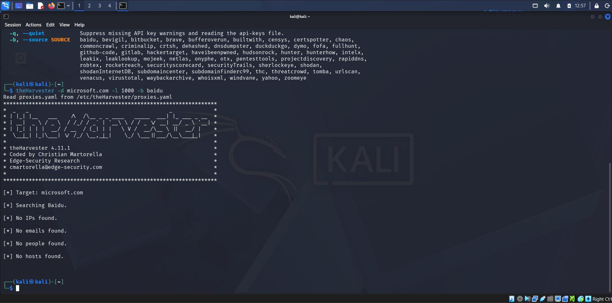
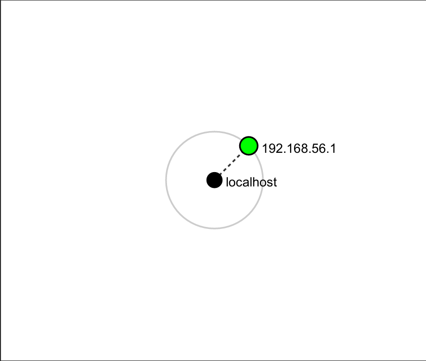

# NETWORKWALKS-DARSH-B084-WK2-FOOTPRINTING-AND-NETWORK-SCANNING

# 🛡️ Penetration Testing Report — Week 2 (Footprinting & Network Scanning)
**Program:** Cybersecurity Internship | **Organization:** Networkwalks  
**Modules Completed:** `W2-PM4` (theHarvester) • `W2-PM5` (Zenmap) • `W2-PM-FINAL`

---

## 📋 Engagement Summary
| Field | Details |
| :--- | :--- |
| **Pentester** | Darsh Khedekar |
| **Program / Batch** | B084-Networkwalks |
| **Date** | 12 November 2026 |
| **Targets** | 1. `microsoft.com` (Passive OSINT Only)<br>2. Local Lab Subnet `192.168.1.0/24` & `192.168.56.1` (Authorized LAN) |
| **Phases Covered** | Phase 1: Footprinting & Reconnaissance<br>Phase 2: Scanning & Host Discovery |

> **⚠️ Legal Disclaimer:** All activities documented in this repository were conducted strictly for educational purposes within authorized lab environments and using passive public OSINT sources.

---

## 🔍 Phase 1: Passive OSINT with `theHarvester` (`W2-PM4`)

### 1. Single-Source Enumeration (`baidu`)
```bash
theHarvester -d microsoft.com -l 1000 -b baidu
```
* **Observation:** Returned `0` IP addresses, `0` emails, `0` personnel names, and `0` hosts, demonstrating the coverage limitations of relying on a single search engine.

### 2. Multi-Source OSINT Aggregation (`all`)
```bash
theHarvester -d microsoft.com -l 50 -b all
```
* **781 Hosts/Subdomains** discovered across Certificate Transparency logs (`crt.sh`, `certspotter`) and passive DNS datasets (`rapiddns`, `hackertarget`, `otx`).
* **1 Primary IPv4 Resolved:** `150.171.109.132` (alongside inline IPv4/IPv6 mappings in host records).
* **3 Corporate Emails Enumerated:** `dotnet-docker-bot@microsoft.com`, `opencode@microsoft.com`, `secure@microsoft.com`.
* **Threat Intelligence (Hudson Rock):** Highlighted historical infostealer exposure metrics (`621,809` compromised records — `16,601` employees & `600,418` users; `44` employee-linked hosts).

<details>
<summary><b>📄 Click to view sample discovered subdomains & terminal summary</b></summary>

```text
[*] Target: microsoft.com
[*] LinkedIn Links found: 0
[*] IPs found: 1
150.171.109.132

[*] Emails found: 3
dotnet-docker-bot@microsoft.com
opencode@microsoft.com
secure@microsoft.com

[*] Hosts found: 781 (Sample)
000dcy1sb2fe2f.redmond.corp.microsoft.com
admin.exchange.microsoft.com
api.sandbox.bingads.microsoft.com
aks-ppe.sceplatform.microsoft.com
fmdmportal-uat.microsoft.com
sharepoint.partners.extranet.microsoft.com
```
</details>

---

## 🌐 Phase 2: Active Host Discovery with `Zenmap` (`W2-PM5`)

### Subnet Ping Sweep
```bash
nmap -sn 192.168.1.0/24
```
Scanned **256 IP addresses in 6.15 seconds**, discovering **4 active hosts** on the local subnet plus the local VirtualBox host-only adapter (`192.168.56.1`):

| Host IP Address | Status & Latency | MAC Address | Identified Hardware Vendor / Role |
| :--- | :--- | :--- | :--- |
| `192.168.1.1` | Host is up (`0.0060s`) | `98:9D:B2:51:C9:0A` | Goip Global Services Pvt. (Local Gateway / Router) |
| `192.168.1.33` | Host is up (Scan Host) | `N/A (Local Interface)` | Scanning Machine (Local Windows Host) |
| `192.168.1.34` | Host is up (`0.11s`) | `D6:03:7D:56:B5:EB` | Unknown (Locally Administered / Randomized MAC) |
| `192.168.1.40` | Host is up (`0.0030s`) | `D4:86:60:48:3D:E2` | Arcadyan (Broadband Router / Extender / Smart Device) |
| `192.168.56.1` | Local Virtual Adapter | `Host-Only Interface` | Localhost VirtualBox Host-Only Adapter |

---

## 📸 Evidences & Screenshots

### 1. `theHarvester` Single-Source Scan (`-b baidu`)


### 2. `theHarvester` Multi-Source Aggregation (`-b all`)


### 3. Zenmap Ping Scan (`nmap -sn 192.168.1.0/24`)


### 4. Exported Zenmap Network Topology


---

## ⚠️ Risk Summary & Mitigations
| # | Finding | Risk Level | Recommended Mitigation |
| :--- | :--- | :--- | :--- |
| 1 | **781 Subdomains & Internal Hostnames Exposed** (`*.corp.*`, UAT/staging) | 🟡 Medium | Use private CAs and split-horizon DNS to avoid leaking internal names into public CT logs; enforce VPN/MFA on staging environments. |
| 2 | **Historical Infostealer Telemetry** (`621,809` compromised records) | 🟡 Medium | Monitor threat-intel feeds and enforce phishing-resistant FIDO2/WebAuthn MFA. |
| 3 | **Public Corporate Emails Enumerated** (3 addresses) | 🟢 Low | Enforce strict SPF, DKIM, and DMARC (`p=reject`) records. |
| 4 | **Internal LAN Hosts & MAC Vendors Visible** | 🟡 Medium | Segment IoT/guest devices onto separate VLANs and enable Dynamic ARP Inspection (DAI). |
| 5 | **Unidentified / Randomized MAC Host** (`192.168.1.34`) | 🟢 Low | Audit DHCP lease tables periodically to verify personal vs. rogue devices. |

---

## 📁 Repository Structure
```text
├── W2-PM-FINAL - Penetration Testing Report.docx   # Full formal penetration testing report
├── WK2 M5 Zenmap Topology.pdf                      # Original exported Zenmap topology PDF
├── theHarvester Terminal.txt                       # Full raw output (781 hosts)
├── theHarvester Results.txt                        # Baidu single-source scan output
└── screenshots/
    ├── theHarvester.jpg
    ├── theHarvester Terminal.jpg
    ├── Zenmap Config.png
    └── zenmap_topology-1.png
```
